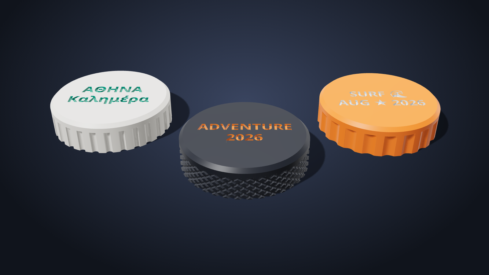
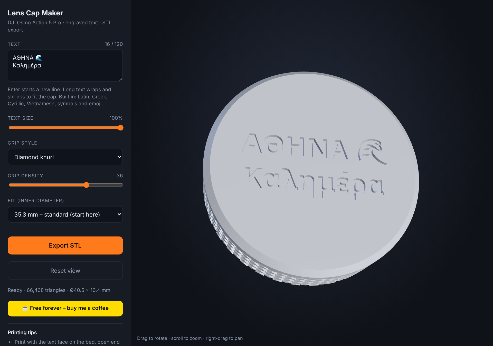
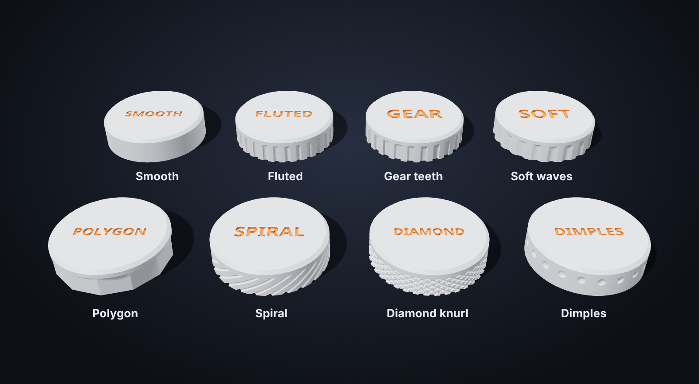
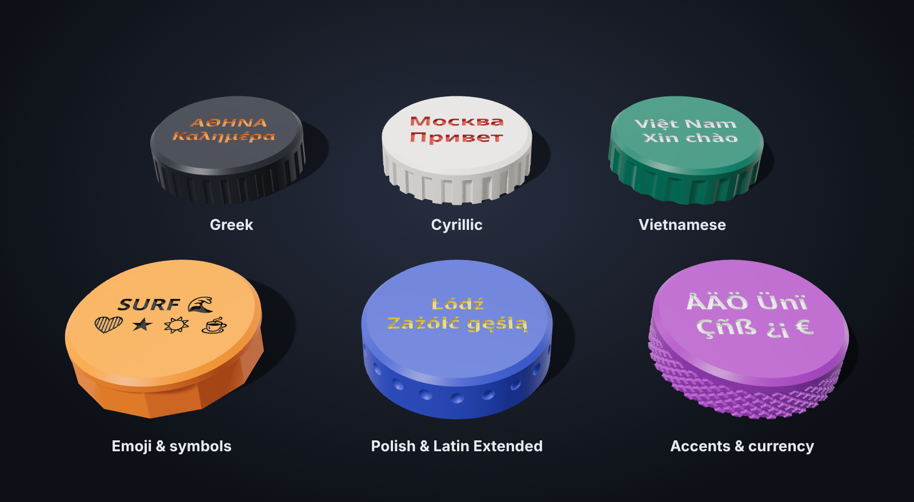
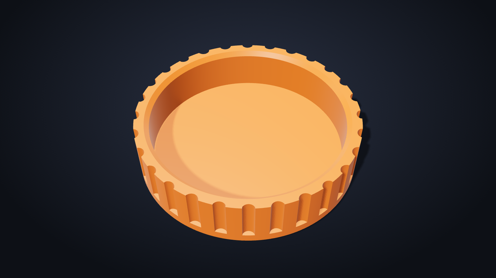

<!-- TODO before publishing: put your name in LICENSE. -->

<h1 align="center">Lens Cap Maker</h1>
<p align="center"><b>Custom engraved lens caps for the DJI Osmo Action 5 Pro. Type your text, pick a grip, download the STL.</b></p>

<p align="center">
  <a href="https://buymeacoffee.com/sgeo"></a>
  &nbsp;
  
  &nbsp;
  
</p>

<p align="center"></p>

<sub>All images in this README are renders of the real generated models, not photos of printed parts. The engraved text is shown filled with a contrasting colour, as you would get by paint-filling the recess.</sub>

## It's free

This project is **free and open source (MIT)**. There is no account, no watermark, no paywall, and nothing is uploaded: the whole tool is one HTML file that runs in your browser, offline.

If it saved you time, or you printed a few caps and liked them, a coffee is appreciated and never expected.

<p align="center"><a href="https://buymeacoffee.com/sgeo"></a></p>

## What you get

- **Your own text on top**: type it, press **Enter** for a new line, up to 120 characters. Long text wraps at spaces and shrinks automatically so it never runs off the cap. Engraved into the top face with a clean, flat surface (no decorative rings).
- **Eight grip styles** for the part you hold, each with a density slider.
- **Many languages, nothing to install or upload**: Latin, Latin Extended, Greek, Cyrillic, Vietnamese, symbols and emoji are built in.
- **Three fits** (35.0 / 35.3 / 35.6 mm bore) plus a custom diameter.
- **Live 3D preview**, then one click to **export a binary STL**.
- Prints **open end up, no supports**.

<p align="center"></p>

## Ways to use it

| Option | How | Needs |
| --- | --- | --- |
| **Online (GitHub Pages)** | Open `https://<your-user>.github.io/<repo>/` | A browser. The live site is the same `index.html`. |
| **Download and run offline** | Download `index.html` from this repo (or the whole zip) and double-click it | A browser. No install, no internet (only the coffee button needs internet). |
| **Ready-made STLs** | Grab a file from [`examples/`](examples) | A slicer. |
| **Build from source** | `npm install && npm run build` | Node.js. See [Build from source](#build-from-source). |

**Deploying your own copy on GitHub Pages:** push the repo, then **Settings → Pages → Build and deployment → Deploy from a branch → `main` / `(root)` → Save**. After a minute the site is live at the address above.

## Quick start

1. Open **`index.html`** in Chrome, Edge, Firefox or Safari (double-click it; it works offline).
2. Type your text, choose a grip and a fit.
3. Click **Export STL** and slice it.

Don't want the tool at all? [`examples/`](examples) has ready-made STLs ("YOUR TEXT", fluted grip) in all three fits.

## Grip styles

<p align="center"></p>

| Style | Look and feel |
| --- | --- |
| Smooth | Plain cylinder. Cleanest print, least grip. |
| Fluted | Round vertical grooves. A good all-rounder. |
| Gear teeth | Square-cut teeth. Very positive grip. |
| Soft waves | Gentle scallops that are easy on the fingers. |
| Polygon | Flat facets (lower density = bolder facets). |
| Spiral | Twisted grooves. |
| Diamond knurl | Criss-cross knurling, like a machined knob. Biggest file. |
| Dimples | Rows of round dimples, staggered. |

The density slider sets the number of grooves, teeth, waves, sides or dimples around the cap. Each style starts at a sensible value when you select it.

## Any language

<p align="center"></p>

Each character picks the first bundled font that has it: [Noto Sans](https://github.com/notofonts) Bold (Latin, Latin Extended, Greek, Cyrillic, Vietnamese), then [Noto Emoji](https://github.com/googlefonts/noto-emoji) (monochrome outline emoji), then Noto Sans Symbols and Symbols 2. Characters no bundled font has are left out and the tool tells you which ones.

Known limits: Chinese, Japanese, Korean, Thai, Arabic, Hebrew and Indic scripts are not included (they need large fonts and, for most, text shaping). Emoji are single-colour outlines without skin tones or joined sequences.

### How text is fitted

Short text stays on one line. When one line would get small (under about 4.5 mm), it wraps at spaces, and only then does it shrink. A single word that is too long is split between characters as a last resort. The text is always kept inside the flat top face, and the tool warns you if letters end up under about 3 mm tall, which is too small to print cleanly.

## Printing

<p align="center"></p>

- **Orientation:** the text face goes on the bed, open end up. No supports.
- **Settings that work well:** 0.2 mm layers, 3 walls, 15-20% infill or more. PETG or PLA both work. A slightly softer material grips the lens ring better.
- **Two-colour text:** the engraving is 0.8 mm deep. Pause at 0.8 mm height (before layer 5 with 0.2 mm layers) and swap filament. Alternatively fill the recess with paint.
- **Fit:** the cap is a friction fit on the lens ring. Print the **35.3 mm** version first. Too tight: use 35.6. Too loose: use 35.0, or enter a custom diameter.

| Fit | Bore | When to use |
| --- | --- | --- |
| Tight | 35.0 mm | Loose caps, or printers that over-extrude slightly |
| Standard | 35.3 mm | Start here |
| Loose | 35.6 mm | Tight fit, or a larger rubber ring |

The bore sizes are in line with community designs for this lens ring, but they have **not been verified against a real camera by the author of this tool**. Measure your own lens ring with calipers and print a test fit before committing to a fancy knurl.

Overall size is `bore + 5.2` mm across (40.5 mm for 35.3) and 10.4 mm tall. The bore is 8 mm deep and the top plate is 2.4 mm.

## Build from source

You only need this to change the tool. The finished tool is `index.html`.

```bash
npm install
npm run build     # bundles src/ into one self-contained index.html
npm test          # builds every grip style and several scripts, checks the meshes are closed
npm run render    # remakes images/ (needs: npm i -D playwright, and a Chromium)
```

```
index.html            the finished tool (generated)
src/core.js           cap geometry, grips, text layout, STL writer
src/main.js           UI, 3D preview, export
src/template.html     page and styles
src/render.js         studio-render page used for the README images
src/fonts/            bundled fonts (SIL OFL, see src/fonts/OFL.txt)
scripts/              build, tests, image renderer
examples/             ready-made STLs
images/               README images
```

How it works: the cap is built with solid-geometry booleans in [manifold-3d](https://github.com/elalish/manifold) (WebAssembly). Text outlines come from [opentype.js](https://github.com/opentypejs/opentype.js), are flattened to polygons and cut into the top face. The preview uses [three.js](https://threejs.org). `npm test` also checks that every edge of the exported mesh is shared by exactly two triangles, which is what slicers need for a clean solid.

## Support the project

It is free and will stay free. If you want to say thanks:

<p align="center"><a href="https://buymeacoffee.com/sgeo"></a></p>

Stars, bug reports, photos of your prints and pull requests are just as welcome.

## License and credits

- Code: [MIT](LICENSE).
- Bundled fonts: Noto Sans, Noto Sans Symbols, Noto Sans Symbols 2 and Noto Emoji, under the [SIL Open Font License 1.1](src/fonts/OFL.txt) (via [Fontsource](https://fontsource.org)).
- Libraries bundled into `index.html`: manifold-3d (Apache-2.0), three.js (MIT), opentype.js (MIT).
- This is an independent fan project. It is **not affiliated with or endorsed by DJI**. "DJI" and "Osmo" are trademarks of SZ DJI Technology Co., Ltd.
